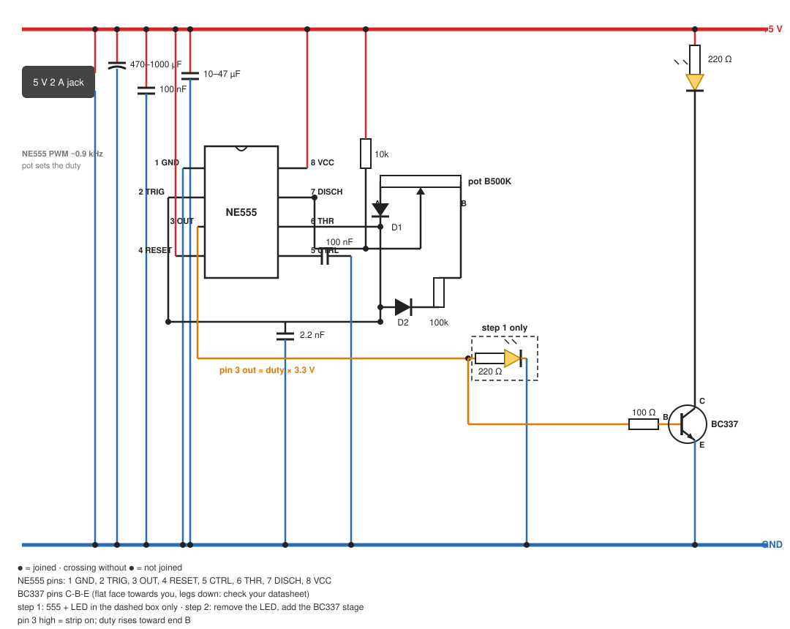

# Canvas Glow breadboard test — IC version (NE555)

Bench steps 1 and 2 of the [IC build guide](GUIDE-IC.md#7-build-order), on a breadboard with jumper wires and no soldering. Everything runs from the 5 V 2 A adapter. Crocodile leads help but are not needed. The finished light is built as in the [IC build guide](GUIDE-IC.md).

## Setup

- Barrel jack + to the + rail, barrel jack − to the GND rail.
- Check the pin order of every part first ([Transistors](GUIDE-IC.md#5-transistors)): NE555 DIP-8, notch at the top, pins counter-clockwise from the top left — 1 GND, 2 TRIG, 3 OUT, 4 RESET on the left; 8 VCC, 7 DISCH, 6 THR, 5 CTRL on the right. BC337 pins C-B-E.
- Stranded wires (barrel pigtail, connector leads) bend in the breadboard holes. Twist them tight, or wrap them round a jumper pin and tape it.

## Step 1: 555 + LED

| From | To |
|---|---|
| + rail | pin 8 (VCC) |
| + rail | pin 4 (RESET) |
| GND rail | pin 1 (GND) |
| pins 2 + 6 tied | 2.2 nF to GND rail |
| pin 5 (CTRL) | 100 nF to GND rail |
| + rail | 100 nF to GND rail next to the chip (decoupling) |
| + rail | pot end 1 |
| pot end 2 | 100 kΩ to pin 7 (DISCH) |
| pot wiper | D1 anode and D2 cathode |
| D1 cathode | pins 2 + 6 |
| D2 anode | pins 2 + 6 |
| pin 3 (OUT) | 220 Ω to LED anode (long leg) |
| LED cathode (short leg, flat side) | GND rail |

Pass: the knob dims the LED from off to bright, with no flicker. If it works backwards, swap the pot's end legs. If it is stuck on or off, the 555 is not oscillating: recheck the pinout (pins 2 + 6 tied, pin 4 to +5V), the diodes are not swapped, and the 2.2 nF is on pins 2 + 6.

## Step 2: power stage

Remove the LED from pin 3, then add:

| From | To |
|---|---|
| pin 3 (OUT) | 100 Ω to BC337 base |
| BC337 E | GND rail |
| BC337 C | LED cathode (short leg, flat side) |
| + rail | 220 Ω to LED anode (long leg) |

Any 3 or 5 mm LED, about 13 mA for a red LED (white/blue run lower, ~7 mA). It tests the switching and the knob. The BC337 drop at real strip current is checked on the finished light ([Checks](GUIDE-IC.md#8-checks)).

Pass: the LED dims smoothly, and the DC voltage on pin 3 tracks the knob (about 0 V at the bottom, about 2.7 V at full).
