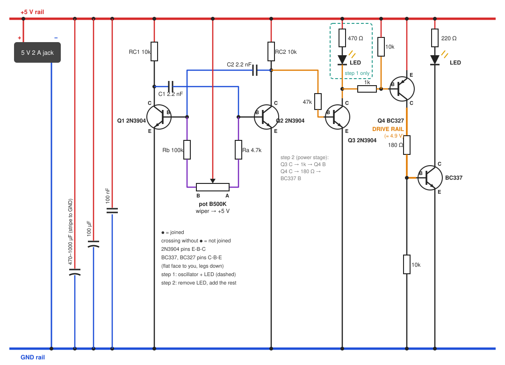

# Canvas Glow breadboard test

Bench steps 1 and 2 of the [build guide](GUIDE.md#7-build-order), on a breadboard with jumper wires and no soldering. Everything runs from the 5 V 2 A adapter. Crocodile leads help but are not needed. The finished light is built as in the [build guide](GUIDE.md).

## Setup

- Barrel jack + to the + rail, barrel jack − to the GND rail.
- Check the pin order of every transistor first ([Transistors](GUIDE.md#5-transistors)): 2N3904 E-B-C, BC337 and BC327 C-B-E.
- Stranded wires (barrel pigtail, connector leads) bend in the breadboard holes. Twist them tight, or wrap them round a jumper pin and tape it.

## Step 1: oscillator + LED

| From | To |
|---|---|
| + rail | RC1 10 kΩ to Q1 C |
| + rail | RC2 10 kΩ to Q2 C |
| + rail | pot wiper (middle leg) |
| pot end A | 4.7 kΩ to Q2 B |
| pot end B | 100 kΩ to Q1 B |
| Q1 C | C1 2.2 nF to Q2 B |
| Q2 C | C2 2.2 nF to Q1 B |
| Q1 E, Q2 E | GND rail |
| Q2 C | 47 kΩ to Q3 B |
| Q3 E | GND rail |
| + rail | 470 Ω to LED anode (long leg) |
| LED cathode (short leg, flat side) | Q3 C |
| 100 µF | across + rail and GND rail near Q1/Q2, stripe (−) to GND |
| 100 nF | across + rail and GND rail next to the 100 µF |

Pass: the knob dims the LED from off (or a faint glow) to bright, with no flicker. If it works backwards, swap the pot's end legs. If it is stuck on or off, the oscillator is not running: recheck the pin orders and C1/C2. Then unplug and replug about 20 times: it should start every time.

## Step 2: power stage

Remove the LED from Q3, then add:

| From | To |
|---|---|
| Q3 C | 1 kΩ to Q4 B |
| Q4 B | 10 kΩ to + rail |
| Q4 E | + rail |
| Q4 C | DRIVE RAIL |
| DRIVE RAIL | 180 Ω to BC337 base |
| BC337 base | 10 kΩ to GND rail |
| BC337 E | GND rail |
| BC337 C | LED cathode (short leg, flat side) |
| + rail | 220 Ω to LED anode (long leg) |

Any 3 or 5 mm LED, about 13 mA. It tests the switching and the knob. The BC337 drop at real strip current is checked on the finished light ([Checks](GUIDE.md#8-checks)).

Pass: the LED dims smoothly, and the DC voltage on the DRIVE RAIL tracks the knob.

---

[← Previous: Discrete build guide](GUIDE.md) · [Contents](../README.md#documentation) · [Next: IC build guide →](GUIDE-IC.md)
