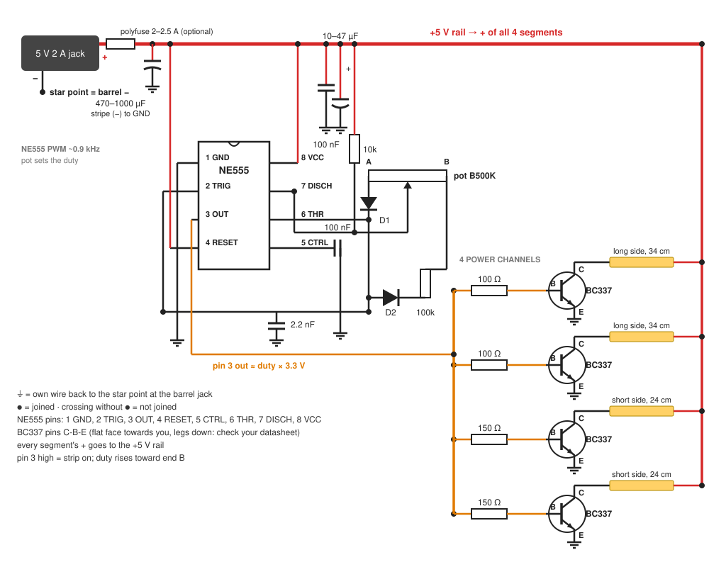

# Canvas Glow build guide — IC version (NE555)

A backlit nightlight behind a stretched-canvas painting. A knob sets the brightness. The PWM comes from an NE555 timer instead of discrete transistors: same strip, same power budget, same light layout as the [discrete version](GUIDE.md), with the oscillator and driver replaced by one chip.

Bench-test on a breadboard first: [BREADBOARD-IC.md](BREADBOARD-IC.md). Everything runs from one 5 V 2 A adapter.

Contents: [Parts](#1-parts) · [Power budget](#2-power-budget) · [How it works](#3-how-it-works) · [Circuit](#4-circuit) · [Transistors](#5-transistors) · [Light layout](#6-light-layout) · [Build order](#7-build-order) · [Checks](#8-checks) · [Troubleshooting](#9-troubleshooting) · [3D prints](#10-3d-prints-bonus) · [Ideas](#11-ideas) · [Relation to the discrete version](#12-relation-to-the-discrete-version)

---

## 1. Parts

| Part | Qty | Notes |
|---|---|---|
| 5 V 2 A adapter, barrel plug | 1 | check centre-positive with a meter |
| Barrel jack pigtail (+/− wires) | 1 | the power entry on the frame; rated 3 A or more |
| 5 V COB strip, 320 LEDs/m, 8 W/m, 3000 K (4 m reel) | ~1.2 m | cut only on the printed cut marks; pitch and rated power vary between strips |
| NE555 timer, DIP-8 | 1 | the PWM oscillator |
| DIP-8 socket | 1 | optional, so the 555 can be swapped |
| BC337 NPN | 4 | strip drivers, see [Transistors](#5-transistors) |
| B500K potentiometer | 1 | brightness knob, plus a knob cap |
| 1N4148 diode | 2 | charge/discharge steering; the banded end is the cathode |
| 100 kΩ resistor | 1 | in the discharge leg, caps the top at ≈81–83% duty |
| 10 kΩ resistor | 2 | pin 7 pull-up, and the optional RESET switch ([Troubleshooting](#9-troubleshooting)) |
| 100 Ω resistor | 2 | BC337 base, long sides |
| 150 Ω resistor | 2 | BC337 base, short sides |
| 220 Ω resistor | 1 | breadboard tests, LED current limit |
| 2.2 nF capacitor (marked 222) | 1 | timing, film or C0G ceramic |
| 100 nF ceramic capacitor | 2 | pin 5 + supply decoupling |
| Electrolytic 470–1000 µF ≥ 16 V | 1 | at the strip power entry, low-ESR type (a low-ESR series such as Panasonic FR/FM or Nichicon HE) |
| Electrolytic 10–47 µF ≥ 16 V | 1 | across +5V/GND right at pins 8/1, + lead to +5V |
| Polyfuse 2–2.5 A | 1 | optional, right after the jack (2–2.5 A = PTC hold current, or slow-blow fuse rating; for a PTC inside a closed frame prefer 2.5 A, see [section 4](#4-circuit)) |
| Latching switch | 1 | optional real off switch on RESET, see [Troubleshooting](#9-troubleshooting) |
| Perfboard, 22–24 AWG silicone wire, heat-shrink, solder | — | 20–22 AWG for the main 5 V / GND feed |
| Breadboard, jumper wires | — | bench tests without soldering, see [BREADBOARD-IC.md](BREADBOARD-IC.md) |
| 3 or 5 mm LED | 1 | for the breadboard tests |
| White foam board or thick white card | 1 | optional back reflector, see [Light layout](#6-light-layout) |

Use a bipolar NE555-class timer for this circuit. Do not substitute a CMOS variant — the TLC555, LMC555 or ICM7555 — without revalidating the output-drive requirements and, if necessary, redesigning the driver stage: their outputs drive far weaker than a bipolar 555's and cannot source the ~87 mA this circuit needs at full brightness.

The datasheet minimum supply is 4.5 V, and the output must source or sink up to 200 mA; the four channels' ~87 mA pin-3 load at full brightness stays inside that.

Tools: multimeter with a 10 A current range (move the red lead to the 10 A jack for current checks, and back to the V jack afterwards), soldering iron, wire strippers and side cutters. To mount: the strip's own adhesive backing or double-sided tape, and heat-shrink over every joint.

## 2. Power budget

The strip is 8 W/m at 5 V, so **1.6 A per metre** at full brightness.

| Item | Current |
|---|---|
| 2 × 0.34 m long sides | 2 × 0.54 A |
| 2 × 0.24 m short sides | 2 × 0.38 A |
| Strip at 100% | 1.86 A |
| 555 + base drive | ~0.1 A |
| Adapter | 2.0 A |

Note: figures are rounded; exact = length × 1.6 A (long sides 0.544 A, short sides 0.384 A, total 1.856 A).

The 8 W/m is the tested strip's rating; cut pitch and rated power vary between strips. Use your strip's rated W/m — current = W/m ÷ 5 V × length — and recompute this section with your actual cut lengths.

1.86 A + 0.1 A is too close to 2 A, so the 100 kΩ in the discharge leg caps the top of the knob at ≈81–83% duty. In theory that puts the strip alone at 0.83 × 1.856 ≈ 1.54 A; simulations with vendor transistor models measure the total at about 1.50–1.54 A from a 5.00 V supply (about 75–77% of the adapter), under the ~1.65 A budget, and ~1.59–1.62 A from an adapter at the top of its tolerance (5.25 V). The strip draws less than theory because it sees ~4.77 V, not 5 V: each BC337 drops ~0.23 V when on, so the ON current is ~1.77 A, not 1.856 A; the 555's base drive adds ~0.07 A. A nightlight usually sits at 10–40%, well under budget. The duty figures are nominal: pot tolerance and part spread move the top by a few points, which is why the Total current check in [section 8](#8-checks) matters.

## 3. How it works

The 555 has two internal thresholds, 1/3 and 2/3 of the supply. Its output flips high when the timing capacitor falls to 1/3 and low when it rises to 2/3. Two diodes steer the capacitor's charge and discharge through opposite sides of the pot: the end-A side (wiper to end A) and the end-B side (wiper to end B). The wiper goes to pin 7, and a 10 kΩ pull-up holds pin 7 at +5 V while the output is high: charging goes 5 V → 10 kΩ → pin 7 → wiper → end-A side → D1 → capacitor. While the output is low, the chip pulls pin 7 to ground: discharging goes capacitor → D2 → 100 kΩ → end-B side → wiper → pin 7. Turning the knob shifts resistance from one path to the other, so the total stays about 610 kΩ and the frequency stays near 0.9 kHz — only the duty changes. Duty = charge resistance (10 kΩ + end-A side) ÷ total resistance. The pot ends never touch +5V: +5 V reaches the timing network only through the 10 kΩ into pin 7, and while the output is low pin 7 takes that current straight to ground, so none of it flows into the capacitor during discharge.

Pin 3 drives the four BC337 bases directly through 100 / 150 Ω. The 555's output swings to about 3.3 V under that load, which is plenty of base drive, and it pulls the bases low when off, so no pulldowns are needed. The bottom of the turn is a faint glow, not off: the 10 kΩ sets a minimum duty of about 2%. Unplug the adapter to switch off (or the RESET switch in Troubleshooting). The pot is linear, so most of the visible change happens in the first third of the turn.

## 4. Circuit



Follow the pin labels on the drawing and your parts' datasheets: pin order varies by maker (see [Transistors](#5-transistors)).

### Power entry

```
5V 2A adapter ── barrel jack ──[polyfuse, optional]──┬──── +5V rail ──► COB+ of all 4 segments, 555 pins 4 + 8
                                                      │
                                         [470–1000µF] across +5V/GND right here (mind polarity)

GND (barrel −) = star point: 4 BC337 emitters, 555 pin 1, bulk capacitor negative
```

- Run the emitter ground wires straight back to the barrel jack. The 555's 100 nF + 10–47 µF return to pin 1, which joins the star point on one wire. Run the +5 V and GND feeds as wire, not perfboard tracks: they carry up to about 2 A.
- Fuse: optional. Most 2 A adapters shut down on a short, but some only cut out well above 2 A. If you have one, put a polyfuse (PTC) with a 2–2.5 A hold current, or a slow-blow (T) fuse of that rating, in the + lead right after the jack — the bulk caps draw inrush on plug-in, which a fast fuse can nuisance-trip on. A PTC's hold current is rated at room temperature and falls as it warms, and the part adds a little series drop. Inside a closed frame a 2 A PTC can trip near the top of the knob, so prefer 2.5 A and check the hold current at the in-frame temperature on its datasheet derating curve. At the top of the knob the board draws about 1.5 A ([section 2](#2-power-budget)); only a fault that leaves the strip fully on reaches about 1.86 A plus base drive (about 1.96 A). A PTC trips at roughly twice its hold current, so it guards against a short, not a mild overload.
- No diode needed: nothing else powers the board; a wrong-polarity adapter would reverse-bias the electrolytics, so the centre-positive meter check in [Parts](#1-parts) is the only protection.

### 555 PWM

```
pins 2 + 6 tied together ──[2.2nF]── GND
pin 5 ──[100nF]── GND
pin 4 ── +5V (must be tied high; a floating reset pin resets the chip at random)
pin 8 ── +5V, pin 1 ── GND, 100nF + 10–47µF across +5V/GND right at the chip
pin 7 ── pot wiper, and pin 7 ──[10k]── +5V (pull-up)
pot end A ── D1 anode, D1 cathode ── pins 2 + 6
pot end B ──[100k]── D2 cathode, D2 anode ── pins 2 + 6
pin 3 ── output to the four BC337 bases
```

NE555 pinout, DIP-8, notch at the top, pins counted counter-clockwise from the top left:

| Pin | Name | Goes to |
|---|---|---|
| 1 | GND | GND rail |
| 2 | TRIG | pins 6 + timing cap + diodes |
| 3 | OUT | BC337 bases through 100 / 150 Ω |
| 4 | RESET | +5V |
| 5 | CTRL | 100 nF to GND |
| 6 | THR | pins 2 + timing cap + diodes |
| 7 | DISCH | pot wiper, 10 kΩ pull-up to +5V |
| 8 | VCC | +5V |

- Total timing resistance stays about 610 kΩ whatever the knob does (10 kΩ pull-up + 500 kΩ pot + 100 kΩ), so the period is ~1.1 ms (~0.9 kHz). The diode drops stretch it past the ideal 0.93 ms but barely change the duty, because charge and discharge stretch by nearly the same factor. Duty is the charge resistance (10 kΩ + end-A side) over the total: about 1.6–2% at end A (a faint glow, not off), ≈81–83% at end B (the 100 kΩ sets this top).
- The timing capacitor can be 1 to 4.7 nF: 1 nF is ~2 kHz, 4.7 nF ~400 Hz. Never 100 nF: ~20 Hz flickers.
- The diodes' banded end is the cathode.
- End A is the counter-clockwise end, end B the clockwise end, so turning clockwise brightens. With the shaft towards you and the legs down, the left leg is usually end A, the middle leg the wiper and the right leg end B. If it runs backwards, swap the two end legs.

### One strip channel (build 4)

```
+5V rail ── COB segment + ... COB segment − ── C
                                               │  NPN (BC337)
pin 3 ──[100Ω long / 150Ω short]────────────── B
                                               │  E
GND ───────────────────────────────────────────┴── star point
```

The base resistors are 100 / 150 Ω because pin 3 sits at about 3.3 V under load. No base pulldowns: pin 3 pulls the bases low itself when the output is off.

## 5. Transistors

Each strip channel needs an NPN that saturates at up to 0.54 A from a ~3.3 V drive.

| Part | Max current | Use here |
|---|---|---|
| **BC337** | 800 mA | first choice, any segment |
| 2N2222A | 600 mA | fine on any segment, runs a little warmer on the long sides |
| S8050 | 500 mA | short sides only (0.38 A) |
| 2N3904, C1815 | 200 / 150 mA | no for the strip, too small |
| MPSA13 | Darlington | no, ~1.5 V drop dims and heats |
| 2N6517 | 500 mA | no, low gain at this current |
| 2N7000 | 200 mA | no for the strip, too small |
| ULN2803, ULN2003 | Darlington array, 500 mA/ch | no, ~1 V saturation drop dims and heats, and the 0.54 A long sides exceed the 500 mA per-channel rating |
| JFETs (J201, 2N38xx, 2N54xx...) | mA range | no |

No other transistors are needed: the 555 drives the BC337 bases directly.

Maker check on the BC337: onsemi rates it 800 mA, but Philips/NXP rates it 500 mA DC (1 A peak). Either is fine here: at the 81–83% cap the long sides peak at 0.54 A and average 0.44–0.45 A — the peak is under onsemi's 800 mA and NXP's 1 A peak and the average is under the 500 mA DC rating and onsemi's 800 mA.

**Short of transistors?** Use fewer segments. Two long sides only (2 × 0.34 m) need two BC337s, draw about 0.88–0.91 A at full (the knob caps below 100% duty), well within the adapter.

**Pin order varies by maker**, so always check, flat face towards you, legs down:
- BC337: C-B-E
- P2N2222A (plastic): often E-B-C; a metal-can 2N2222A has a different layout, check its datasheet

With a meter on diode test, red lead on one leg and black on each of the others:
- the base is the leg that reads about 0.6–0.7 V to **both** other legs;
- base-to-emitter reads a few mV **higher** than base-to-collector.

A meter with an hFE socket also works.

## 6. Light layout

Inner opening: 36 × 25.8 cm (the tested painting's — measure your own opening and size the segments from it).

- Fix one segment along the inner face of each stretcher bar: ~34 cm on the long sides and ~24 cm on the short sides, rounded to the nearest cut marks (the pitch varies between strips — use your strip's).
- **Aim and test before fixing anything.** Strips facing straight across the canvas back leave the centre dim. Two layouts are usually more even:
  - strips angled about 45° towards the canvas (3D-printed clips, [section 10](#10-3d-prints-bonus));
  - **reflector back**: strips aimed at a white foam board that closes the back, so the canvas is lit by the bounce. This is the most even option, and the board also keeps dust out.
- Keep strips, wires and the board at least 1 cm off the canvas. Nothing hard should press into the painting.
- Heat: at nightlight levels the strip barely warms. If you ever run it at full for hours, check that the strip stays only finger-warm.

## 7. Build order

1. **Bench, 555 + LED** ([breadboard](BREADBOARD-IC.md)): the 555 and an LED on the adapter. Check that the knob dims the LED from a faint glow to bright, with no flicker and no dead zone (it must brighten continuously through the whole travel).
2. **Bench, power stage** ([breadboard](BREADBOARD-IC.md)): one BC337, an LED. Check that the knob dims the LED smoothly.
3. **Light layout test**: tape segments in place temporarily and try angles and the reflector with the painting upright in a dark room.
4. **Build the board**: 555, 4 channels and the power entry on perfboard (tape-insulate the underside), plus the knob. Leave the strips unconnected.
5. **First power-up, no strips**: plug in and measure the +5 V rail against GND. It must read about +5 V; a minus sign means the adapter or jack is wired backwards, so unplug at once (the electrolytics are reversed). Then check that the DC voltage on pin 3 follows the knob, with the same readings as the Duty check in section 8. Unplug.
6. **Wire the strips**: tin each segment's + and − pads and solder a wire to each (the pads are marked + and −). Every segment's + goes to the +5 V rail; each segment's − goes to its own BC337 collector, long sides on the 100 Ω channels, short sides on the 150 Ω channels. Connect one segment, plug in, check it lights and dims with the knob, unplug, then add the next.
7. **Mount** the board, the strips and the knob on the stretcher bars, wires clear of the canvas ([section 6](#6-light-layout)).
8. Run every check in section 8 (the two oscilloscope checks are optional).

## 8. Checks

The meter checks below read steady or average quantities, which a DC multimeter can do. The transistor drop and the strip voltage are PWM-switched: a DC meter reads their average, which moves with the knob, so no fixed threshold works — use the optional oscilloscope checks below instead.

| Check | How | Pass |
|---|---|---|
| Strip current | wire one segment straight to 5 V with the meter (10 A jack) in series | about 1.6 A × length |
| Duty | multimeter, DC volts on pin 3, knob at bottom and at top | average ≈ duty × pin 3 high level (typically 3.3 V, datasheet minimum 2.75 V at 100 mA): about 0.06 V at the bottom, about 2.7 V at full (down to about 2.3 V on a weak chip) |
| Total current | meter in series with the barrel + wire, everything at full | at most ~1.65 A; if higher, raise the 100 kΩ to 120 kΩ |
| VCC at pin 8 | multimeter, DC volts from pin 8 to GND, everything at full, the current meter out of the circuit | ≥ 4.5 V (datasheet minimum supply); sag is worst at full load, so test there |
| Heat | 30 min at full | strip, transistors and the board only finger-warm |
| Reboot | unplug and replug about 20 times, with the knob low, mid and high | comes up at the knob level every time, no blink |

**Optional, needs an oscilloscope: transistor saturation.** Knob at full. Probe a BC337's collector against circuit ground — probe ground clip on the GND rail. The on-state plateau should be a few tenths of a volt at most (Ic ~0.54 A; about 0.25 V in sims of this circuit, datasheet maximum 0.7 V at 500 mA); a plateau near 5 V means the transistor is not switching on.

**Optional, needs an oscilloscope: strip voltage.** Two channels both referenced to circuit ground — the strip + rail on one, the far segment's − (the switched collector) on the other, subtracted — or a differential probe. The on-state level should sit just under the 5 V rail — ~4.75 V in sims, the rail minus the BC337's ~0.25 V saturation drop (its datasheet allows up to 0.7 V at 500 mA). Never clip an ordinary grounded scope's ground to the switched collector or a strip terminal: it shorts that node to earth.

## 9. Troubleshooting

| Symptom | Try |
|---|---|
| Nothing lights, even at the top of the knob | measure the +5 V rail at the board: 0 V means the adapter, the jack wiring or a tripped polyfuse; −5 V means reversed polarity, so unplug at once; +5 V means the 555: see the next row |
| Light stuck fully on or off | the 555 is not oscillating: check the DIP-8 pinout (pins 2 + 6 tied, pin 4 to +5V, pin 5 cap), the wiper goes to pin 7 with the 10 kΩ pull-up and good contact, the diodes are not swapped, the 2.2 nF is on pins 2 + 6 (a floating wiper freezes it fully on or off). If it is frozen fully on, unplug it rather than leave it running: full on draws about 1.86 A plus base drive (about 1.96 A), over the ~1.65 A operating budget |
| Output flips at random | pin 4 floating: tie it to +5V |
| Visible flicker | timing cap too big: use 2.2 nF or smaller |
| Works backwards | swap the two end legs |
| One segment dark | that BC337's pin order, base resistor, the segment's +/− wires |
| Adapter cuts out or the polyfuse trips | unplug; look for a short between +5 V and GND (a solder bridge, a strip − wire touching GND) or a light stuck fully on, then run the Total current check in [section 8](#8-checks) |
| Electrolytic hot, bulging or hissing | unplug now: it is in backwards or the adapter is centre-negative. Replace it even if it still works |
| One segment much dimmer than the others | that segment's feed wires (too thin, or a poor joint) and its base resistor value |
| A part gets hot | a BC337: not switching fully on, check its base resistor value and pin order; the 555: pin 3 overloaded, check for a short on pin 3 and that the base resistors are 100 / 150 Ω, not 10 / 15 Ω |
| All dim | thicker feed wire, check the adapter; check pin 3 reads ~2.7 V DC at full (peak ~3.3 V; a chip at the datasheet minimum reads ~2.3 V DC, 2.75 V peak); see section 8 for how to measure the strip voltage |
| Max too dim | lower the 100 kΩ to 82 kΩ, only after checking total current |
| Faint glow at the bottom of the turn | that's the minimum duty (~1.6–2%): unplug the adapter to switch off, or add a RESET switch (below) |
| Want a real off switch | replace the direct pin 4 → +5V tie with a 10 kΩ pull-up to +5V, and wire a latching switch (not a momentary button) from pin 4 to GND; closing it forces the output low (strip off) |

## 10. 3D prints (bonus)

Print anything near the strip in **PETG**: PLA softens around 55 °C. Models are not included — no files, dimensions or links; design them for your own frame and strip.

- 45° strip clips for the stretcher bars (8 mm strip)
- A box for the 555 perfboard, screwed to a bar
- A panel mount for the barrel jack with a cable strain relief
- A bracket for the knob, plus a knob cap
- Wall spacers, if you also want a glow on the wall behind the painting (needs strips facing backwards)

## 11. Ideas

- **Hidden message**: write or paint something on the back of the canvas. It only shows when the light is on.
- **Halo**: extra strip on the outside back of the frame, facing the wall.
- **Candle or breathing mode**, Wi-Fi control or an auto-on-at-dark sensor: these need a microcontroller, which this build does not have.

## 12. Relation to the discrete version

Same strip, power entry, light layout, checks and troubleshooting shape as [GUIDE.md](GUIDE.md). The only change is the PWM source: the NE555 and its two steering diodes replace the Q1/Q2 astable, the Q3 buffer and the Q4 high-side switch, and pin 3 drives the BC337 bases directly. The 555 circuit is the standard diode-steered form: wiper to pin 7, 10 kΩ pull-up, pot ends to D1 and (via 100 kΩ) D2. The pot ends never touch +5V: +5 V reaches the timing network only through the 10 kΩ pull-up, which pin 7 grounds during discharge. Everything downstream of pin 3 is identical except the base resistors (100 / 150 Ω instead of 180 / 270 Ω, because pin 3 sits at ~3.3 V instead of the 4.9 V drive rail) and the dropped base pulldowns (pin 3 pulls the bases low itself).

---

[← Previous: Discrete breadboard test](BREADBOARD.md) · [Contents](../README.md#documentation) · [Next: IC breadboard test →](BREADBOARD-IC.md)
