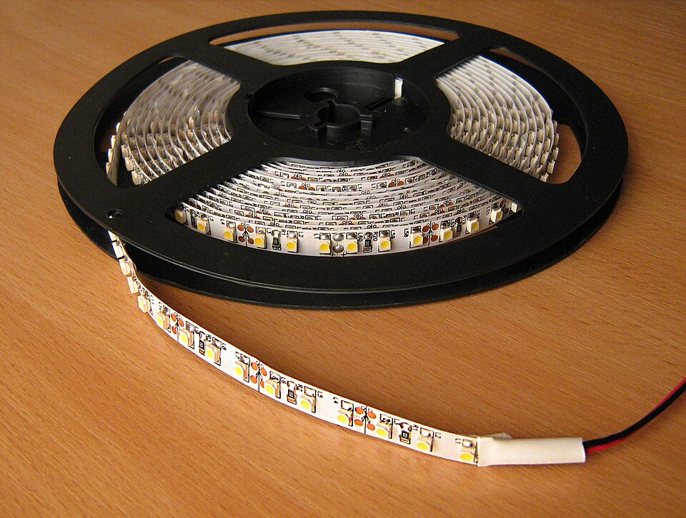
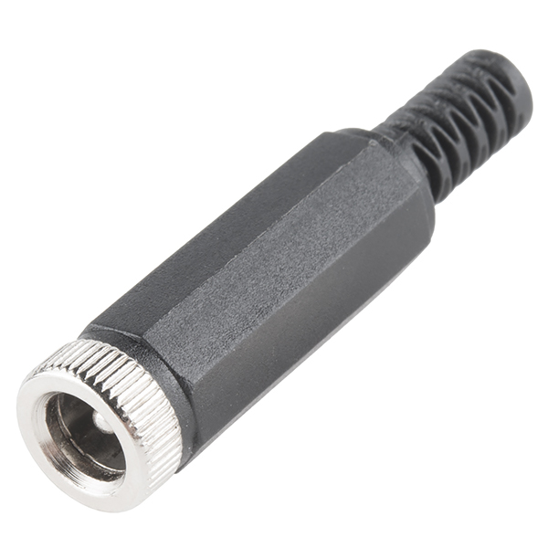
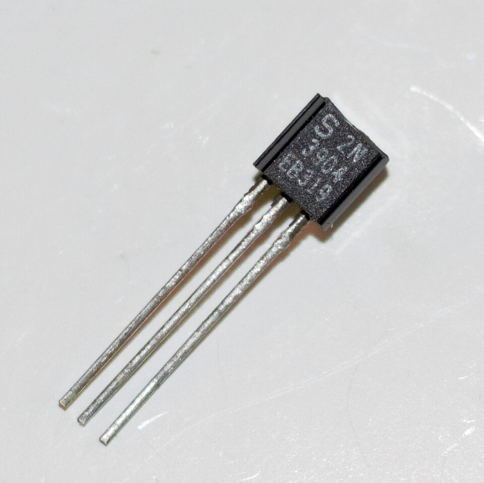
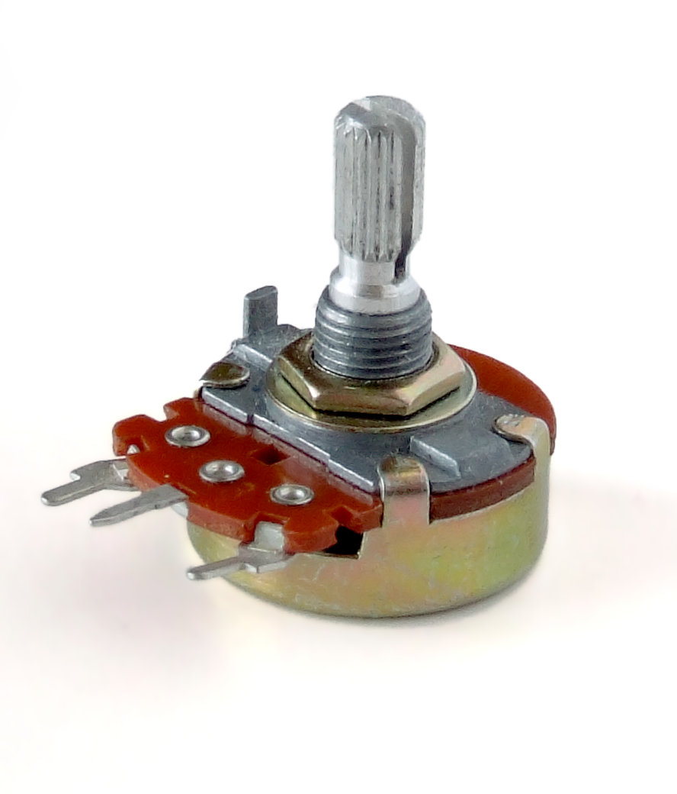
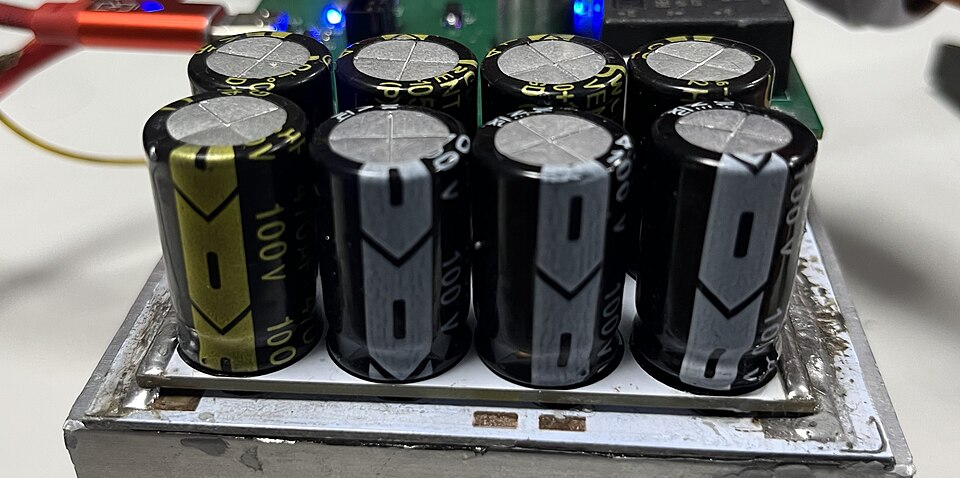
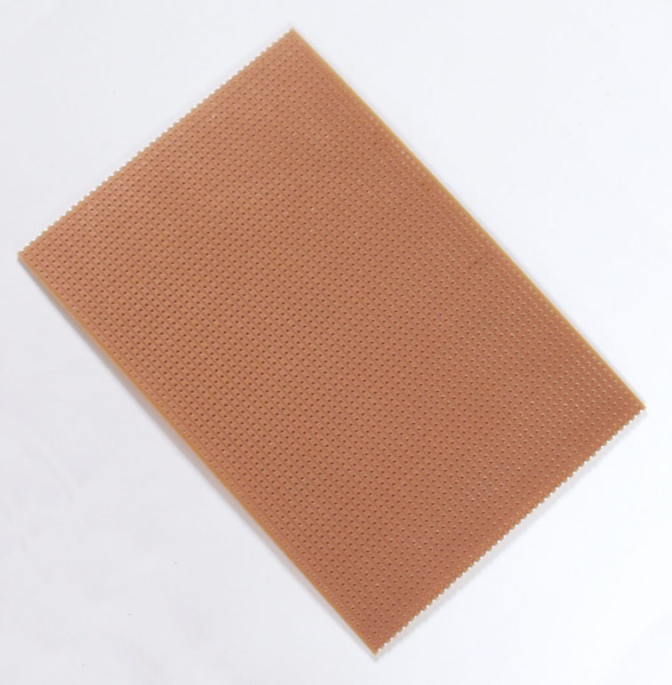
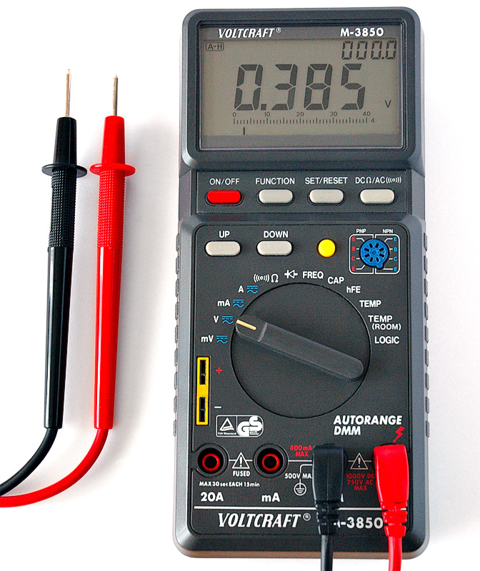
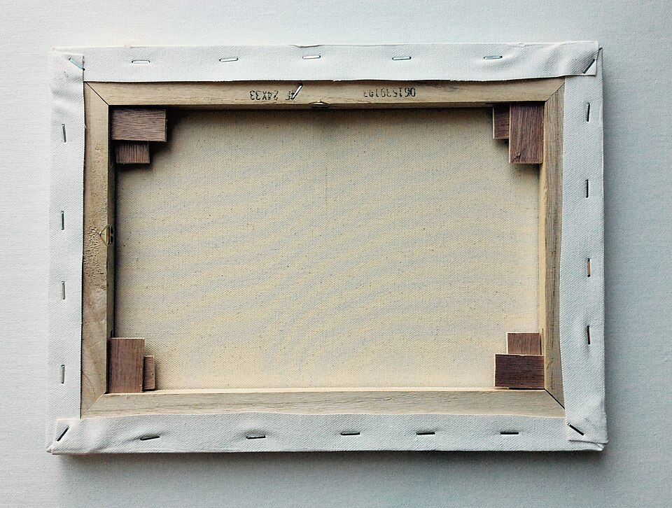

# Canvas Glow build guide

A backlit nightlight behind a stretched-canvas painting. A knob sets the brightness. No microcontroller: two transistors make a ~1 kHz PWM signal and four transistors switch the strip.

Bench-test on a breadboard first: [BREADBOARD.md](BREADBOARD.md). Everything runs from one 5 V 2 A adapter.

Contents: [Parts](#1-parts) · [Power budget](#2-power-budget) · [How it works](#3-how-it-works) · [Circuit](#4-circuit) · [Transistors](#5-transistors) · [Light layout](#6-light-layout) · [Build order](#7-build-order) · [Checks](#8-checks) · [Troubleshooting](#9-troubleshooting) · [3D prints](#10-3d-prints-bonus) · [Ideas](#11-ideas) · [Changes from v5](#12-changes-from-the-v5-guide)

---

## 1. Parts

| Part | Qty | Notes |
|---|---|---|
| 5 V 2 A adapter, barrel plug | 1 | check centre-positive with a meter |
| Barrel jack pigtail (+/− wires) | 1 | the power entry on the frame; rated 3 A or more |
| 5 V COB strip, 320 LEDs/m, 8 W/m, 3000 K (4 m reel) | ~1.2 m | cut only on the printed cut marks; pitch and rated power vary between strips |
| BC337 NPN | 4 | strip drivers, see [Transistors](#5-transistors) |
| 2N3904 NPN | 3 | the oscillator and its output buffer (BC337 also works, with less margin: 5 V VEBO against a ~4.2 V reverse base swing; a base-emitter junction driven past VEBO slowly loses gain; pins differ) |
| BC327 PNP | 1 | drives the four BC337 bases |
| B500K potentiometer | 1 | brightness knob, plus a knob cap |
| 10 kΩ resistor | 7 | RC1, RC2, Q4 pull-up, 4 base pulldowns |
| 4.7 kΩ resistor | 1 | Ra |
| 100 kΩ resistor | 1 | Rb |
| 47 kΩ resistor | 1 | Q3 base |
| 1 kΩ resistor | 1 | Q3 collector to Q4 base |
| 180 Ω resistor | 2 | BC337 base, long sides |
| 270 Ω resistor | 2 | BC337 base, short sides |
| 470 Ω resistor | 1 | breadboard test Step 1, LED current limit |
| 220 Ω resistor | 1 | breadboard test Step 2, LED current limit |
| 2.2 nF capacitor (marked 222) | 2 | C1, C2: a matched pair (same value, type and tolerance; no need to measure them), film or C0G ceramic |
| 100 nF ceramic capacitor | 1 | oscillator supply |
| Electrolytic 100 µF ≥ 16 V | 1 | oscillator supply |
| Electrolytic 470–1000 µF ≥ 16 V | 1 | at the strip power entry, low-ESR type (a low-ESR series such as Panasonic FR/FM or Nichicon HE) |
| Polyfuse 2–2.5 A | 1 | optional, right after the jack (2–2.5 A = PTC hold current, or slow-blow fuse rating; for a PTC inside a closed frame prefer 2.5 A, see [section 4](#4-circuit)) |
| Perfboard, 22–24 AWG silicone wire, heat-shrink, solder | — | 20–22 AWG for the main 5 V / GND feed |
| Breadboard, jumper wires | — | bench tests without soldering, see [BREADBOARD.md](BREADBOARD.md) |
| 3 or 5 mm LED | 1 | for the breadboard tests |
| White foam board or thick white card | 1 | optional back reflector, see [Light layout](#6-light-layout) |

Tools: multimeter with a 10 A current range (move the red lead to the 10 A jack for current checks, and back to the V jack afterwards), soldering iron, wire strippers and side cutters. To mount: the strip's own adhesive backing or double-sided tape, and heat-shrink over every joint.

### What the main parts look like

<table>
<tr><td align="center"><br><b>LED strip</b><br><sub>SMD strip shown; a COB strip looks like one continuous line of light</sub><br><sub>Photo: <a href="https://commons.wikimedia.org/wiki/File:LED_strip_on_reel.jpg">Andrey Gvrv</a>, <a href="https://creativecommons.org/licenses/by-sa/3.0/">CC BY-SA 3.0</a></sub></td><td align="center"><br><b>Barrel jack</b><br><sub>an inline socket, like the one on a pigtail</sub><br><sub>Photo: <a href="https://commons.wikimedia.org/wiki/File:DC_Barrel_Jack_Plug_-_Female_(15584438461).jpg">SparkFun Electronics</a>, <a href="https://creativecommons.org/licenses/by/2.0/">CC BY 2.0</a></sub></td><td align="center"><br><b>TO-92 transistor</b><br><sub>2N3904 shown; the BC337 and BC327 use the same package</sub><br><sub>Photo: <a href="https://commons.wikimedia.org/wiki/File:2N3904_NPN_Transistor.jpg">WaxPhilosophic</a>, <a href="https://creativecommons.org/licenses/by-sa/4.0/">CC BY-SA 4.0</a></sub></td></tr>
<tr><td align="center"><br><b>Potentiometer</b><br><sub>three legs: two ends and the wiper</sub><br><sub>Photo: <a href="https://commons.wikimedia.org/wiki/File:Potentiometer.jpg">Iainf</a>, <a href="https://creativecommons.org/licenses/by/2.5/">CC BY 2.5</a></sub></td><td align="center"><br><b>Electrolytic capacitors</b><br><sub>the stripe marks −</sub><br><sub>Photo: <a href="https://commons.wikimedia.org/wiki/File:Aluminium_Electrolytic_Capacitors.jpg">Brihaspati</a>, <a href="https://creativecommons.org/licenses/by-sa/4.0/">CC BY-SA 4.0</a></sub></td><td align="center"><br><b>Prototyping board</b><br><sub>stripboard shown; perfboard has separate pads</sub><br><sub>Photo: <a href="https://commons.wikimedia.org/wiki/File:Stripboard.jpg">Alexander Jones</a>, Public domain</sub></td></tr>
<tr><td align="center"><br><b>Multimeter</b><br><sub>with its test leads</sub><br><sub>Photo: <a href="https://commons.wikimedia.org/wiki/File:Digital_Multimeter_Aka.jpg">André Karwath (Aka)</a>, <a href="https://creativecommons.org/licenses/by-sa/2.5/">CC BY-SA 2.5</a></sub></td></tr>
</table>

## 2. Power budget

The strip is 8 W/m at 5 V, so **1.6 A per metre** at full brightness.

| Item | Current |
|---|---|
| 2 × 0.34 m long sides | 2 × 0.54 A |
| 2 × 0.24 m short sides | 2 × 0.38 A |
| Strip at 100% | 1.86 A |
| Oscillator + base drive | ~0.1 A |
| Adapter | 2.0 A |

Note: figures are rounded; exact = length × 1.6 A (long sides 0.544 A, short sides 0.384 A, total 1.856 A).

The 8 W/m is the tested strip's rating; cut pitch and rated power vary between strips. Use your strip's rated W/m — current = W/m ÷ 5 V × length — and recompute this section with your actual cut lengths.

**In short:** 1.86 A + 0.1 A is too close to 2 A, so Rb caps the top of the knob at about 86% duty. A nightlight usually sits at 10–40%, well under budget.

The detail:

- **Theory:** the cap puts the strip alone at 0.86 × 1.856 ≈ 1.60 A.
- **Simulation:** with vendor transistor models the total is about 1.59 A from a 5.00 V supply (about 79% of the adapter), under the ~1.65 A budget.
- **Why the strip draws less than theory (~1.51 A):** it sees ~4.76 V, not 5 V. Each BC337 drops ~0.24 V when on, so the ON current is ~1.77 A, not 1.856 A. Base drive and the oscillator add ~0.08 A.
- **High adapter:** one at the top of its tolerance (5.25 V) pushes the total to ~1.67 A, just over budget.
- **Part spread:** the duty figures are nominal. Pot tolerance and part spread move the top by a few points, which is why the Total current check in [section 8](#8-checks) matters.

## 3. How it works

The signal passes through four stages:

1. **Oscillator (Q1, Q2):** an astable multivibrator. Each one's collector charges a capacitor that turns the other on. The pot sits in the timing resistors, so turning it changes how long Q2 stays off while the total period stays near 1 ms (~1 kHz). The strip is on while Q2 is off, so the pot sets the duty cycle.
2. **Buffer (Q3):** buffers Q2's collector through a 47k base resistor, so it barely loads the oscillator, and pulls Q4 on.
3. **High-side switch (Q4):** puts nearly 5 V on the drive rail, which feeds the four BC337 bases through 180 / 270 Ω.
4. **Strip drivers (4 × BC337):** each one switches one strip segment.

- The bottom of the turn is fully off or a faint glow, depending on the parts: the shortest pulse is only ~7 µs, which Q3 and Q4 barely pass. Unplug the adapter to switch off.
- The pot is linear, so most of the visible change happens in the first third of the turn.

## 4. Circuit


Follow the pin labels on the drawing and your parts' datasheets: pin order varies by maker (see [Transistors](#5-transistors)).

### Power entry

```
5V 2A adapter ── barrel jack ──[polyfuse, optional]──┬──── +5V rail ──► COB+ of all 4 segments, oscillator, Q4
                                                      │
                                         [470–1000µF] across +5V/GND right here (mind polarity)

GND (barrel −) = star point: 4 BC337 emitters, Q3 emitter, oscillator GND, bulk capacitor negative
```

- **Grounds.** Run the emitter ground wires straight back to the barrel jack. The oscillator's 100 µF + 100 nF return to its own GND, which joins the star point on one wire. Run the +5 V and GND feeds as wire, not perfboard tracks: they carry up to about 2 A.
- **Fuse (optional).** Most 2 A adapters shut down on a short, but some only cut out well above 2 A. If you have one, put a polyfuse (PTC) with a 2–2.5 A hold current, or a slow-blow (T) fuse of that rating, in the + lead right after the jack — the bulk caps draw inrush on plug-in, which a fast fuse can nuisance-trip on.
  - A PTC's hold current is rated at room temperature and falls as it warms, and the part adds a little series drop. Inside a closed frame a 2 A PTC can trip near the top of the knob, so prefer 2.5 A and check the hold current at the in-frame temperature on its datasheet derating curve.
  - At the top of the knob the board draws about 1.6 A ([section 2](#2-power-budget)); only a fault that leaves the strip fully on reaches about 1.86 A plus base drive (about 1.96 A).
  - A PTC trips at roughly twice its hold current, so it guards against a short, not a mild overload.
- **No reverse-polarity diode.** Nothing else powers the board; a wrong-polarity adapter would reverse-bias the electrolytics, so the centre-positive meter check in [Parts](#1-parts) is the only protection.

### Oscillator

```
+5V ──[RC1 10k]── Q1 C ──[C1 2.2nF]──► Q2 B
+5V ──[RC2 10k]── Q2 C ──[C2 2.2nF]──► Q1 B    (Q2 C also goes to Q3 via 47k)

pot end B ──[Rb 100k]── Q1 B
pot end A ──[Ra 4.7k]── Q2 B
pot wiper (middle leg) ── +5V

Q1 E, Q2 E ── GND
100µF + 100nF across +5V/GND next to Q1/Q2
```

- C1 goes from Q1's collector to Q2's base. C2 goes from Q2's collector to Q1's base.
- Total timing resistance stays about 605 kΩ whatever the knob does, so the period is ~0.92 ms.
- Q2's off-time is 0.693 × C1 × (Ra + the pot's A-side). That gives:
  - pot at end A: about 0.8% duty in theory (in practice ~0, see above);
  - pot at end B: about 83% in theory, simulated ~86% (78–86% across the runs in sim/README.md). Rb sets this top. The sim reads a few points high because Vbe/Vce thresholds lengthen Q2's off-time and Q3's 47k caps Q2's collector swing at ~4.25 V, shortening Q1's off-time.
- C1 = C2 can be any matched pair from 1 to 4.7 nF: 1 nF is ~2.4 kHz, 4.7 nF ~500 Hz. Never 100 nF: ~20 Hz flickers.
- End A is the counter-clockwise end, end B the clockwise end, so clockwise brightens. With the shaft towards you and the legs down, the left leg is usually end A, the middle leg the wiper and the right leg end B. The drawings place the pot's ends where they are wired, not in leg order: wire by the A/B labels.
- If the knob works backwards, swap the pot's two end legs.

### Driver

```
Q2 C ──[47k]── Q3 B (2N3904 NPN)
          Q3 E ── GND
          Q3 C ──[1k]──┬── Q4 B (BC327 PNP)
                           [10k] to +5V (keeps Q4 off)
          Q4 E ── +5V
          Q4 C ── DRIVE RAIL

DRIVE RAIL ──[180Ω]── BC337 B   (long side, ×2)
DRIVE RAIL ──[270Ω]── BC337 B   (short side, ×2)
```

### One strip channel (build 4)

```
+5V rail ── COB segment + ... COB segment − ── C
                                               │  NPN (BC337)
DRIVE RAIL ──[180Ω long / 270Ω short]──┬────── B
                                       [10kΩ]  │
                                        │      E
GND ────────────────────────────────────┴──────┴── star point
```

The base resistors are 180 / 270 Ω because the drive rail sits at about 4.9 V.

## 5. Transistors

Each strip channel needs an NPN that saturates at up to 0.54 A from a ~4.9 V drive.

| Part | Max current | Use here |
|---|---|---|
| **BC337** | 800 mA | first choice, any segment |
| 2N2222A | 600 mA | fine on any segment, runs a little warmer on the long sides |
| S8050 | 500 mA | short sides only (0.38 A) |
| 2N3904, C1815 | 200 / 150 mA | no for the strip, too small (fine in the oscillator) |
| MPSA13 | Darlington | no, ~1.5 V drop dims and heats |
| 2N6517 | 500 mA | no, low gain at this current |
| 2N7000 | 200 mA | no for the strip, too small |
| JFETs (J201, 2N38xx, 2N54xx...) | mA range | no |

Oscillator and driver parts: Q1, Q2, Q3 = 2N3904 (BC337 also works, with less margin on its 5 V VEBO), Q3 always through its 47k base resistor; Q4 = BC327 (2N2907 or S8550 also work, mind the pins).

Maker check on the BC337: onsemi rates it 800 mA, but Philips/NXP rates it 500 mA DC (1 A peak). Either is fine here. At the 86% cap the long sides:

- peak at 0.54 A — under onsemi's 800 mA and NXP's 1 A peak;
- average about 0.46 A — under the 500 mA DC rating and onsemi's 800 mA, though with less margin than the IC version.

**Short of transistors?** Use fewer segments. Two long sides only (2 × 0.34 m) need two BC337s, draw about 0.94 A at full (the knob caps below 100% duty), well within the adapter.

<p align="center"><br><sub>TO-92 transistor: 2N3904 shown; the BC337 and BC327 use the same package. Photo: <a href="https://commons.wikimedia.org/wiki/File:2N3904_NPN_Transistor.jpg">WaxPhilosophic</a>, <a href="https://creativecommons.org/licenses/by-sa/4.0/">CC BY-SA 4.0</a></sub></p>

**Pin order varies by maker**, so always check, flat face towards you, legs down:
- 2N3904: E-B-C
- BC337, BC327: C-B-E
- P2N2222A (plastic): often E-B-C; a metal-can 2N2222A has a different layout, check its datasheet

With a meter on diode test, red lead on one leg and black on each of the others:
- the base is the leg that reads about 0.6–0.7 V to **both** other legs;
- base-to-emitter reads a few mV **higher** than base-to-collector.
- for the BC327 (PNP), swap the leads: black on the base, red on each of the others.

A meter with an hFE socket also works.

## 6. Light layout

<p align="center"><br><sub>Back of a stretched canvas: the strips go on the inner faces of these stretcher bars. Photo: <a href="https://commons.wikimedia.org/wiki/File:Stretcher_bars.jpg">JohanahoJ</a>, <a href="https://creativecommons.org/licenses/by-sa/4.0/">CC BY-SA 4.0</a></sub></p>

Inner opening: 36 × 25.8 cm (the tested painting's — measure your own opening and size the segments from it).

- Fix one segment along the inner face of each stretcher bar: ~34 cm on the long sides and ~24 cm on the short sides, rounded to the nearest cut marks (the pitch varies between strips — use your strip's).
- **Aim and test before fixing anything.** Strips facing straight across the canvas back leave the centre dim. Two layouts are usually more even:
  - strips angled about 45° towards the canvas (3D-printed clips, [section 10](#10-3d-prints-bonus));
  - **reflector back**: strips aimed at a white foam board that closes the back, so the canvas is lit by the bounce. This is the most even option, and the board also keeps dust out.
- Keep strips, wires and the board at least 1 cm off the canvas. Nothing hard should press into the painting.
- Heat: at nightlight levels the strip barely warms. If you ever run it at full for hours, check that the strip stays only finger-warm.

## 7. Build order

1. **Bench, oscillator + LED** ([breadboard](BREADBOARD.md)): Q1–Q3 and an LED on the adapter. Check that the knob dims the LED from almost off to bright, with no flicker.
2. **Bench, power stage** ([breadboard](BREADBOARD.md)): Q4, one BC337, an LED. Check that the knob dims the LED smoothly.
3. **Light layout test**: tape segments in place temporarily and try angles and the reflector with the painting upright in a dark room.
4. **Build the board**: oscillator, driver and 4 channels on perfboard (tape-insulate the underside), the power entry and the knob. Leave the strips unconnected.
5. **First power-up, no strips**: plug in and measure the +5 V rail against GND. It must read about +5 V; a minus sign means the adapter or jack is wired backwards, so unplug at once (the electrolytics are reversed). Then check that the DC voltage on the DRIVE RAIL follows the knob, with the same readings as the Duty check in section 8. Unplug.
6. **Wire the strips**: tin each segment's + and − pads and solder a wire to each (the pads are marked + and −). Every segment's + goes to the +5 V rail; each segment's − goes to its own BC337 collector, long sides on the 180 Ω channels, short sides on the 270 Ω channels. Connect one segment, plug in, check it lights and dims with the knob, unplug, then add the next.
7. **Mount** the board, the strips and the knob on the stretcher bars, wires clear of the canvas ([section 6](#6-light-layout)).
8. Run every check in section 8 (the two oscilloscope checks are optional).

## 8. Checks

The meter checks below read steady or average quantities, which a DC multimeter can do. The transistor drop and the strip voltage are PWM-switched: a DC meter reads their average, which moves with the knob, so no fixed threshold works — use the optional oscilloscope checks below instead.

| Check | How | Pass |
|---|---|---|
| Strip current | wire one segment straight to 5 V with the meter (10 A jack) in series | about 1.6 A × length |
| Duty | multimeter, DC volts on the DRIVE RAIL, knob at bottom and at top, the current meter out of the circuit | average ≈ duty × 4.9 V: ~0–0.1 V at the bottom, about 4.2 V at full |
| Total current | meter in series with the barrel + wire, everything at full | at most ~1.65 A; if higher, raise Rb to 120k |
| Heat | 30 min at full | strip, transistors and the board only finger-warm |
| Reboot | unplug and replug about 20 times, with the knob low, mid and high | comes up at the knob level every time, no blink |

**Optional, needs an oscilloscope: transistor saturation.** Knob at full. Probe a BC337's collector against circuit ground — probe ground clip on the GND rail. The on-state plateau should be a few tenths of a volt at most (Ic ~0.54 A; about 0.25 V in sims of this circuit, datasheet maximum 0.7 V at 500 mA); a plateau near 5 V means the transistor is not switching on.

**Optional, needs an oscilloscope: strip voltage.** Two channels both referenced to circuit ground — the strip + rail on one, the far segment's − (the switched collector) on the other, subtracted — or a differential probe. The on-state level should sit just under the 5 V rail — ~4.75 V in sims, the rail minus the BC337's ~0.25 V saturation drop (its datasheet allows up to 0.7 V at 500 mA). Never clip an ordinary grounded scope's ground to the switched collector or a strip terminal: it shorts that node to earth.

## 9. Troubleshooting

| Symptom | Try |
|---|---|
| Nothing lights, even at the top of the knob | measure the +5 V rail at the board: 0 V means the adapter, the jack wiring or a tripped polyfuse; −5 V means reversed polarity, so unplug at once; +5 V means the oscillator or driver: see the next row, and check Q4's pin order and its 1k |
| Light stuck fully on or off | the oscillator is not running: check the 2N3904 pin order, C1/C2 placement, RC1/RC2, Q3's 47k |
| Off after plugging in, fine after a replug | the oscillator powered up with Q1 and Q2 both on. Sims start it on every power-up from mid to top, even on a 1 s supply ramp. In the bottom ~10% of the turn Q1 and Q2 do sit both on, which only means off, and turning the knob up releases them. If it happens higher up, replug and recheck C1/C2 and the pot wiring |
| Visible flicker | C1/C2 too big: use 2.2 nF or smaller |
| Works backwards | swap the pot's two end legs |
| One segment dark | that BC337's pin order, base resistor, the segment's +/− wires |
| Adapter cuts out or the polyfuse trips | unplug; look for a short between +5 V and GND (a solder bridge, a strip − wire touching GND) or a light stuck fully on, then run the Total current check in [section 8](#8-checks) |
| Electrolytic hot, bulging or hissing | unplug now: it is in backwards or the adapter is centre-negative. Replace it even if it still works |
| One segment much dimmer than the others | that segment's feed wires (too thin, or a poor joint) and its base resistor value |
| A part gets hot | a BC337: not switching fully on, check its base resistor value and pin order; a base resistor: wrong value (18 Ω for 180 Ω); Q4: its pin order and the 1k |
| All dim | thicker feed wire, check the adapter; check Q4 saturates (drive rail ≈4.2 V DC at full, scope peak ≈4.9 V); see section 8 for how to measure the strip voltage |
| Max too dim | lower Rb to 82k, only after checking total current |
| Faint glow at the bottom of the turn | expected on some parts: unplug the adapter to switch off |
| Jumps to full, knob does nothing | pot wiper lost contact: both bases float and the light goes full on — about 1.86 A plus base drive (about 1.96 A), over the ~1.65 A operating budget. Unplug it and do not leave it running; reseat or replace the pot |

## 10. 3D prints (bonus)

Print anything near the strip in **PETG**: PLA softens around 55 °C. Models are not included — no files, dimensions or links; design them for your own frame and strip.

- 45° strip clips for the stretcher bars (8 mm strip)
- A box for the driver perfboard, screwed to a bar
- A panel mount for the barrel jack with a cable strain relief
- A bracket for the knob, plus a knob cap
- Wall spacers, if you also want a glow on the wall behind the painting (needs strips facing backwards)

## 11. Ideas

- **Hidden message**: write or paint something on the back of the canvas. It only shows when the light is on.
- **Halo**: extra strip on the outside back of the frame, facing the wall.
- **Candle or breathing mode**, Wi-Fi control or an auto-on-at-dark sensor: these need a microcontroller, which this build does not have.

## 12. Changes from the v5 guide

The original is kept in [`reference/canvas-glow-v5.html`](reference/canvas-glow-v5.html).

- ESP32 and firmware dropped for a discrete 2-transistor PWM oscillator; knob-only, no hover sensor, no mode switch.
- The strip is split into four segments only so that each transistor stays in its rating.
- One 5 V 2 A adapter for everything (was two USB supplies). Added bulk capacitors; dropped the PTC fuse requirement, USB breakout and second cable.
- Top of the knob capped at ~86% duty by Rb to stay within the adapter budget.
- Added a transistor substitution table.
- Dropped: the 5 mm LED fallback, the PTC section and the old dated schedule.

---

[← Previous: README](../README.md) · [Contents](../README.md#documentation) · [Next: Discrete breadboard test →](BREADBOARD.md)
