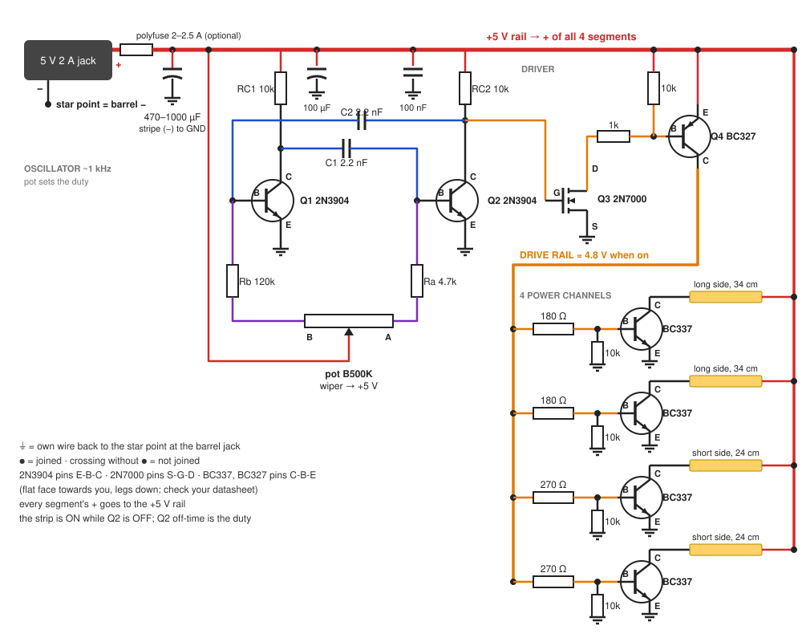

# Canvas Glow build guide

A backlit nightlight behind a stretched-canvas painting. A knob sets the brightness. No microcontroller: two transistors make a ~1 kHz PWM signal and four transistors switch the strip.

Bench-test on a breadboard first: [BREADBOARD.md](BREADBOARD.md). Everything runs from one 5 V 2 A adapter.

Contents: [Parts](#1-parts) · [Power budget](#2-power-budget) · [How it works](#3-how-it-works) · [Circuit](#4-circuit) · [Transistors](#5-transistors) · [Light layout](#6-light-layout) · [Build order](#7-build-order) · [Checks](#8-checks) · [Troubleshooting](#9-troubleshooting) · [3D prints](#10-3d-prints-bonus) · [Ideas](#11-ideas) · [Changes from v5](#12-changes-from-the-v5-guide)

---

## 1. Parts

| Part | Qty | Notes |
|---|---|---|
| 5 V 2 A adapter, barrel plug | 1 | check centre-positive with a meter |
| Barrel jack pigtail (+/− wires) | 1 | the power entry on the frame |
| 5 V COB strip, 320 LEDs/m, 8 W/m, 3000 K (4 m reel) | ~1.2 m | cut only on the printed cut marks |
| BC337 NPN | 4 | strip drivers, see [Transistors](#5-transistors) |
| 2N3904 NPN | 3 | the oscillator and its output buffer (BC337 also works, pins differ) |
| BC327 PNP | 1 | drives the four BC337 bases |
| B500K potentiometer | 1 | brightness knob, plus a knob cap |
| 10 kΩ resistor | 7 | RC1, RC2, Q4 pull-up, 4 base pulldowns |
| 4.7 kΩ resistor | 1 | Ra |
| 100 kΩ resistor | 1 | Rb |
| 47 kΩ resistor | 1 | Q3 base |
| 1 kΩ resistor | 1 | Q3 collector to Q4 base |
| 180 Ω resistor | 2 | BC337 base, long sides |
| 270 Ω resistor | 2 | BC337 base, short sides |
| 2.2 nF capacitor (marked 222) | 2 | C1, C2 |
| 100 nF ceramic capacitor | 1 | oscillator supply |
| Electrolytic 100 µF ≥ 10 V | 1 | oscillator supply |
| Electrolytic 470–1000 µF ≥ 10 V | 1 | at the strip power entry |
| Polyfuse 2–2.5 A | 1 | optional, right after the jack |
| Perfboard, 22–24 AWG silicone wire, heat-shrink, solder | — | 20–22 AWG for the main 5 V / GND feed |
| Breadboard, jumper wires | — | bench tests without soldering, see [BREADBOARD.md](BREADBOARD.md) |
| White foam board or thick white card | 1 | optional back reflector, see [Light layout](#6-light-layout) |

Tools: multimeter, soldering iron.

## 2. Power budget

The strip is 8 W/m at 5 V, so **1.6 A per metre** at full brightness.

| Item | Current |
|---|---|
| 2 × 0.34 m long sides | 2 × 0.54 A |
| 2 × 0.24 m short sides | 2 × 0.38 A |
| Strip at 100% | 1.86 A |
| Oscillator + base drive | ~0.1 A |
| Adapter | 2.0 A |

1.86 A + 0.1 A is too close to 2 A, so Rb caps the top of the knob at about 83% duty. That keeps the strip near 1.55 A and the total near 1.65 A (about 83% of the adapter). A nightlight usually sits at 10–40%, well under budget.

## 3. How it works

Q1 and Q2 form an astable multivibrator: each one's collector charges a capacitor that turns the other on. The pot sits in the timing resistors, so turning it changes how long Q2 stays off while the total period stays near 1 ms (~1 kHz). The strip is on while Q2 is off, so the pot sets the duty cycle. Q3 buffers Q2's collector through a 47k base resistor, so it barely loads the oscillator, and pulls Q4 on. Q4 puts nearly 5 V on the drive rail, which feeds the four BC337 bases through 180 / 270 Ω. Each BC337 switches one strip segment.

The bottom of the turn is fully off or a faint glow, depending on the parts: the shortest pulse is only ~7 µs, which Q3 and Q4 barely pass. Unplug the adapter to switch off. The pot is linear, so most of the visible change happens in the first third of the turn.

## 4. Circuit



Follow the pin labels on the drawing and your parts' datasheets: pin order varies by maker (see [Transistors](#5-transistors)).

### Power entry

```
5V 2A adapter ── barrel jack ──[polyfuse, optional]──┬──── +5V rail ──► COB+ of all 4 segments, oscillator, Q4
                                                      │
                                         [470–1000µF] across +5V/GND right here (mind polarity)

GND (barrel −) = star point: 4 BC337 emitters, Q3 emitter, oscillator GND, all capacitor negatives
```

- Run the emitter ground wires straight back to the barrel jack. The oscillator GND joins at the star point.
- Fuse: optional. Most 2 A adapters shut down on a short, but some only cut out well above 2 A. If you have one, put a 2–2.5 A polyfuse (PTC) or fast fuse in the + lead right after the jack.
- No diode needed: nothing else powers the board.

### Oscillator

```
+5V ──[RC1 10k]── Q1 C ──[C1 2.2nF]──► Q2 B
+5V ──[RC2 10k]── Q2 C ──[C2 2.2nF]──► Q1 B    (Q2 C also goes to Q3 via 47k)

pot end B ──[Rb 100k]── Q1 B
pot end A ──[Ra 4.7k]── Q2 B
pot wiper (middle leg) ── +5V

Q1 E, Q2 E ── GND
100µF + 100nF across +5V/GND next to Q1/Q2
```

- C1 goes from Q1's collector to Q2's base. C2 goes from Q2's collector to Q1's base.
- Total timing resistance stays about 605 kΩ whatever the knob does, so the period is ~0.92 ms. Q2's off-time is 0.693 × C1 × (Ra + the pot's A-side), which gives about 0.8% duty in theory with the pot at end A (in practice ~0, see above) and about 83% at end B (Rb sets this top).
- C1 = C2 can be any matched pair from 1 to 4.7 nF: 1 nF is ~2.4 kHz, 4.7 nF ~500 Hz. Never 100 nF: ~20 Hz flickers.
- If the knob works backwards, swap the pot's two end legs.

### Driver

```
Q2 C ──[47k]── Q3 B (2N3904 NPN)
          Q3 E ── GND
          Q3 C ──[1k]──┬── Q4 B (BC327 PNP)
                           [10k] to +5V (keeps Q4 off)
          Q4 E ── +5V
          Q4 C ── DRIVE RAIL

DRIVE RAIL ──[180Ω]── BC337 B   (long side, ×2)
DRIVE RAIL ──[270Ω]── BC337 B   (short side, ×2)
```

### One strip channel (build 4)

```
+5V rail ── COB segment + ... COB segment − ── C
                                               │  NPN (BC337)
DRIVE RAIL ──[180Ω long / 270Ω short]──┬────── B
                                       [10kΩ]  │
                                        │      E
GND ────────────────────────────────────┴──────┴── star point
```

The base resistors are 180 / 270 Ω because the drive rail sits at about 4.8 V.

## 5. Transistors

Each strip channel needs an NPN that saturates at up to 0.54 A from a ~4.8 V drive.

| Part | Max current | Use here |
|---|---|---|
| **BC337** | 800 mA | first choice, any segment |
| 2N2222A | 600 mA | fine on any segment, runs a little warmer on the long sides |
| S8050 | 500 mA | short sides only (0.38 A) |
| 2N3904, C1815 | 200 / 150 mA | no for the strip, too small (fine in the oscillator) |
| MPSA13 | Darlington | no, ~1.5 V drop dims and heats |
| 2N6517 | 500 mA | no, low gain at this current |
| 2N7000 | 200 mA | no for the strip, too small |
| JFETs (J201, 2N38xx, 2N54xx...) | mA range | no |

Oscillator and driver parts: Q1, Q2, Q3 = 2N3904 (BC337 also works), Q3 always through its 47k base resistor; Q4 = BC327 (2N2907 or S8550 also work, mind the pins).

**Short of transistors?** Use fewer segments. Two long sides only (2 × 0.34 m) need two BC337s, draw 1.09 A at full, well within the adapter.

**Pin order varies by maker**, so always check, flat face towards you, legs down:
- 2N3904: E-B-C
- BC337, BC327: C-B-E
- P2N2222A: often E-B-C

With a meter on diode test, red lead on one leg and black on each of the others:
- the base is the leg that reads about 0.6–0.7 V to **both** other legs;
- base-to-emitter reads a few mV **higher** than base-to-collector.

A meter with an hFE socket also works.

## 6. Light layout

Inner opening: 36 × 25.8 cm.

- Fix one segment along the inner face of each stretcher bar: ~34 cm on the long sides and ~24 cm on the short sides, rounded to the nearest cut marks.
- **Aim and test before fixing anything.** Strips facing straight across the canvas back leave the centre dim. Two layouts are usually more even:
  - strips angled about 45° towards the canvas (3D-printed clips, [section 10](#10-3d-prints-bonus));
  - **reflector back**: strips aimed at a white foam board that closes the back, so the canvas is lit by the bounce. This is the most even option, and the board also keeps dust out.
- Keep strips, wires and the board at least 1 cm off the canvas. Nothing hard should press into the painting.
- Heat: at nightlight levels the strip barely warms. If you ever run it at full for hours, check that the strip stays only finger-warm.

## 7. Build order

1. **Bench, oscillator + LED** ([breadboard](BREADBOARD.md)): Q1–Q3 and an LED on the adapter. Check that the knob dims the LED from almost off to bright, with no flicker.
2. **Bench, power stage** ([breadboard](BREADBOARD.md)): Q4, one BC337, an LED. Check that the knob dims the LED smoothly.
3. **Light layout test**: tape segments in place temporarily and try angles and the reflector with the painting upright in a dark room.
4. **Build the harness**: oscillator, driver and 4 channels on perfboard (tape-insulate the underside), the power entry and the knob. Mount everything on the stretcher bars.
5. Run every check in section 8.

## 8. Checks

| Check | How | Pass |
|---|---|---|
| Strip current | wire one segment straight to 5 V with the meter (10 A jack) in series | about 1.6 A × length |
| Duty | multimeter, DC volts on the DRIVE RAIL, knob at bottom and at top | average ≈ duty × 4.8 V: 0 to 0.05 V at the bottom, about 4.0 V at full |
| Transistor drop | knob at full; measure collector to emitter of a BC337 | under 0.4 V good; over 0.6 V → lower that base resistor to 150 Ω (long) or 220 Ω (short) |
| Strip voltage | at full, across the far segment's + and − | 4.5 V or more |
| Total current | meter in series with the barrel + wire, everything at full | at most ~1.65 A; if higher, raise Rb to 120k |
| Heat | 30 min at full | strip, transistors and the board only finger-warm |
| Reboot | unplug and replug | comes up at the knob level, no blink |

## 9. Troubleshooting

| Symptom | Try |
|---|---|
| Light stuck fully on or off | the oscillator is not running: check the 2N3904 pin order, C1/C2 placement, RC1/RC2, Q3's 47k |
| Off after plugging in, fine after a replug | the oscillator powered up with Q1 and Q2 both on; rare, replug |
| Visible flicker | C1/C2 too big: use 2.2 nF or smaller |
| Works backwards | swap the pot's two end legs |
| One segment dark | that BC337's pin order, base resistor, the segment's +/− wires |
| All dim | strip voltage under 4.5 V: thicker feed wire, check the adapter; check Q4 saturates (drive rail 4.6 V or more at full) |
| Max too dim | lower Rb to 82k, only after checking total current |
| Faint glow at the bottom of the turn | expected on some parts: unplug the adapter to switch off |
| Jumps to full, knob does nothing | pot wiper lost contact: both bases float and the light goes full on. Reseat or replace the pot |

## 10. 3D prints (bonus)

Print anything near the strip in **PETG**: PLA softens around 55 °C.

- 45° strip clips for the stretcher bars (8 mm strip)
- A box for the driver perfboard, screwed to a bar
- A panel mount for the barrel jack with a cable strain relief
- A bracket for the knob, plus a knob cap
- Wall spacers, if you also want a glow on the wall behind the painting (needs strips facing backwards)

## 11. Ideas

- **Hidden message**: write or paint something on the back of the canvas. It only shows when the light is on.
- **Halo**: extra strip on the outside back of the frame, facing the wall.
- **Candle or breathing mode**, Wi-Fi control or an auto-on-at-dark sensor: these need a microcontroller, which this build does not have.

## 12. Changes from the v5 guide

The original is kept in [`reference/canvas-glow-v5.html`](reference/canvas-glow-v5.html).

- ESP32 and firmware dropped for a discrete 2-transistor PWM oscillator; knob-only, no hover sensor, no mode switch.
- The strip is split into four segments only so that each transistor stays in its rating.
- One 5 V 2 A adapter for everything (was two USB supplies). Added bulk capacitors; dropped the PTC fuse requirement, USB breakout and second cable.
- Top of the knob capped at ~81% duty by Rb to stay within the adapter budget.
- Added a transistor substitution table.
- Dropped: the 5 mm LED fallback, the PTC section and the old dated schedule.

---

[← Previous: README](../README.md) · [Contents](../README.md#documentation) · [Next: Discrete breadboard test →](BREADBOARD.md)
